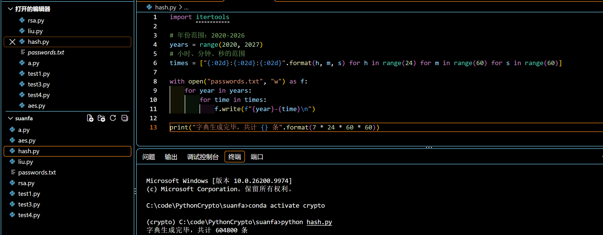

# shadow 哈希识别与口令爆破

> 比赛：ISCC 2026　方向：Crypto　作者：杨心凌
>
> 仅在赛事授权的题目环境中复现。靶场地址与口令已按投稿规范脱敏。

## 题目信息

- **题目描述：** 某单位一台 Ubuntu Linux 服务器因管理不当存在账号泄露，泄露内容为 `/etc/shadow`。需要回答 root 口令使用的加密算法，并根据题目给出的口令格式爆破口令，通过 SSH 登录后读取 `/root/flag.txt`。
- **附件与环境：** 题目以文本形式提供 shadow 内容；需要可访问的 SSH 服务（端口 22，允许 root 远程登录）。
- **关键线索：** root 的哈希为：

  ```text
  root:$6$team185salt$lo5ied8uJ5Oymj/4YNSDbRzpuq3QyObgV0oGCP.aODhGgQGiISj2CjMYNxZX1SY.CEJorf9KJeCw1Pb5VUoIf1:19000:0:99999:7:::
  ```

  口令格式为 `yyyy-hh:mm:ss`，年份在 2020 年至 2026 年之间。

## 解题思路

1. **识别算法。** Linux crypt 哈希通过前缀区分：`$1$` 为 md5-crypt、`$5$` 为 sha256crypt、`$6$` 为 sha512crypt、`$y$` 为 yescrypt。本题以 `$6$` 开头，因此是 **SHA-512 crypt**，选择题选 D。
2. **评估爆破空间。** 格式固定为“4 位年份-2 位小时:2 位分钟:2 位秒”，年份仅 2020–2026 共 7 种，时间部分 24×60×60 = 86400 种，候选口令总数 7×86400 = 604800 条，字典爆破成本很低。
3. **生成字典并爆破。** 用 Python 按格式生成 `passwords.txt`，再用 hashcat（`-m 1800`）或 john 对哈希爆破。

## 分析与复现

### 第一步：生成候选口令字典



```python
import itertools

with open("passwords.txt", "w", encoding="utf-8") as f:
    for year in range(2020, 2027):
        for h, m, s in itertools.product(range(24), range(60), range(60)):
            f.write(f"{year}-{h:02d}:{m:02d}:{s:02d}\n")
```

共生成 7 × 24 × 60 × 60 = 604800 条候选。

### 第二步：用 hashcat 爆破

```bash
# 将 root 哈希单独保存到 root.hash
hashcat -m 1800 root.hash passwords.txt
hashcat -m 1800 root.hash passwords.txt --show
```

`-m 1800` 即 sha512crypt。hashcat 对含特殊字符的明文会以 `$HEX[...]` 形式回显，转换后即为 `yyyy-hh:mm:ss` 格式的 root 口令（本文按规范脱敏）。

也可以使用 john：

```bash
john --format=sha512crypt --wordlist=passwords.txt root.hash
john --show --format=sha512crypt root.hash
```

### 第三步：登录并读取 Flag

```bash
ssh root@<靶场地址>
cat /root/flag.txt
```

## 核心代码

```python
import itertools

# 按题目给定格式生成字典
with open("passwords.txt", "w", encoding="utf-8") as f:
    for year in range(2020, 2027):
        for h, m, s in itertools.product(range(24), range(60), range(60)):
            f.write(f"{year}-{h:02d}:{m:02d}:{s:02d}\n")
```

```bash
hashcat -m 1800 root.hash passwords.txt
hashcat -m 1800 root.hash passwords.txt --show
```

## 结果验证

hashcat 命中候选并在 `--show` 输出中以 `$HEX[...]` 形式给出明文，转成文本后得到符合 `yyyy-hh:mm:ss` 的 root 口令。用该口令 SSH 登录，读取 `/root/flag.txt` 后提交，平台返回正确。

## 复盘与经验

- **关键知识点：** crypt 哈希前缀与算法对照、受限格式口令的字典爆破、hashcat 模式 `-m 1800`。
- **容易踩的坑：** 哈希本身不能“解密”，只能爆破/猜测；`$6$` 与 `$5$` 容易混淆；hashcat 的 `$HEX[...]` 只是显示方式，不是额外编码。
- **后续改进：** 服务器应禁用 root 密码远程登录，改用密钥与普通用户提权；口令应使用足够熵的随机值。

## 参考资料

- [hashcat - Example Hashes](https://hashcat.net/wiki/doku.php?id=example_hashes) — sha512crypt 的 `-m 1800` 模式。
- [crypt(5) - Linux manual page](https://man7.org/linux/man-pages/man5/crypt.5.html) — `$1$`/`$5$`/`$6$` 前缀含义。
