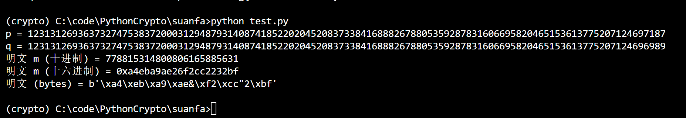

# 费马分解 RSA

> 比赛：ISCC 2026　方向：Crypto　作者：杨心凌
>
> 仅在赛事授权的题目环境中复现。

## 题目信息

- **题目描述：** 给定 RSA 公钥参数与密文，要求解出明文。题目提示在 PythonCrypto 环境中完成。
- **已知参数：**

  ```text
  e = 65537
  n = 1516130949512411069481425281701662651618052751090524034315480505884815383482789928057498446121725076123523174508917063677901933636830873429144811792032403456254350562520361235888930942999607856274670897650113739014543795755669943
  c = 1314921355168251159043668685129001846005723345284197813883451672614683655449683618394114314040848175959723650775378959779085979023683657787683553204007736625300564350147666011979094367130428740573893661750600188988834322086124300
  ```

- **关键线索：** n 的两个素因子非常接近，常规的小指数攻击不适用，但可以用费马分解。

## 解题思路

费马分解利用 `n = a² - b² = (a+b)(a-b)`：从 `a = ceil(sqrt(n))` 开始，检查 `a² - n` 是否为完全平方；若是，则 `p = a-b`、`q = a+b` 即得两个因子。

因为 p、q 接近，b 很小，循环次数通常很少。得到 p、q 后：

- `φ(n) = (p-1)(q-1)`
- `d = e^{-1} mod φ(n)`
- `m = c^d mod n`，再按需转成十进制/字节。

## 分析与复现

### 第一步：费马分解

```python
from math import isqrt

n = 1516130949512411069481425281701662651618052751090524034315480505884815383482789928057498446121725076123523174508917063677901933636830873429144811792032403456254350562520361235888930942999607856274670897650113739014543795755669943

a = isqrt(n)
if a * a < n:
    a += 1

while True:
    b2 = a * a - n
    b = isqrt(b2)
    if b * b == b2:
        break
    a += 1

p, q = a - b, a + b
print("p =", p)
print("q =", q)
```

运行结果：



### 第二步：计算私钥并解密

```python
e = 65537
c = 1314921355168251159043668685129001846005723345284197813883451672614683655449683618394114314040848175959723650775378959779085979023683657787683553204007736625300564350147666011979094367130428740573893661750600188988834322086124300

phi = (p - 1) * (q - 1)
d = pow(e, -1, phi)
m = pow(c, d, n)

print("m(dec) =", m)
print("m(hex) =", hex(m))
print("m(bytes) =", m.to_bytes((m.bit_length() + 7) // 8, "big"))
```

输出：`m(十进制) = 778815314800806165885631`，`m(十六进制) = 0xa4eba9ae26f2cc2232bf`，字节为 `b'\xa4\xeb\xa9\xae&\xf2\xcc"2\xbf'`。

## 核心代码

```python
from math import isqrt

def fermat_factor(n: int) -> tuple[int, int]:
    a = isqrt(n)
    if a * a < n:
        a += 1
    while True:
        b2 = a * a - n
        b = isqrt(b2)
        if b * b == b2:
            return a - b, a + b
        a += 1

p, q = fermat_factor(n)
phi = (p - 1) * (q - 1)
d = pow(65537, -1, phi)
m = pow(c, d, n)
print(m)
```

## 结果验证

解出的十进制明文 `m` 与题目预期的提交值一致；字节形式为不可打印数据，说明本题要提交的是整数形式的结果（以平台判题结果为准）。

## 复盘与经验

- **关键知识点：** 费马分解适用于 `p`、`q` 相差很小（n 接近完全平方）的 RSA。
- **容易踩的坑：** `isqrt` 后忘记向上取整；`a²-n` 非平方时 `a` 递增方向搞反。
- **后续改进：** 生成 RSA 密钥时 `p`、`q` 必须独立随机且足够远离，否则会被费马分解快速攻破。

## 参考资料

- [Wikipedia - Fermat's factorization method](https://en.wikipedia.org/wiki/Fermat%27s_factorization_method) — 算法原理与复杂度。
