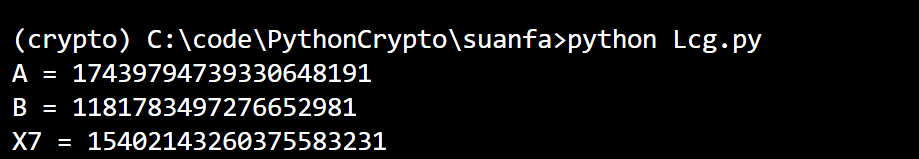

# LCG 随机数预测

> 比赛：ISCC 2026　方向：Crypto　作者：杨心凌
>
> 仅在赛事授权的题目环境中复现。靶场地址已脱敏。

## 题目信息

- **题目描述：** 服务器使用线性同余发生器（LCG）生成随机数：

  ```text
  X_{i+1} = (X_i × A + B) mod Q
  ```

  其中 A、B 为未知的 64 位参数，模数 Q 已知。服务器展示连续 6 个随机数，要求预测第 7 个随机数，猜对即可获得 Flag。
- **附件与环境：** 题目提供服务地址与 6 个输出；需要可交互的题目服务。
- **关键线索：** `Q = 18446744073709551557`，前 6 个随机数为：

  ```text
  X1 = 18204427520581419483
  X2 = 244937675628804245
  X3 = 9626350492994711494
  X4 = 7141741930835377386
  X5 = 14745190532722645120
  X6 = 1135305059617886174
  ```

## 解题思路

LCG 的未知量只有 A 和 B。对相邻项作差可以把 B 消掉：

```text
D_i = X_{i+1} - X_i = A × (X_i - X_{i-1}) = A × D_{i-1}  (mod Q)
```

于是 `A = D_1 × D_0^{-1} mod Q`，再由 `B = X_1 - A × X_0 mod Q` 求出 B，最后用递推式计算 `X_7 = A × X_6 + B mod Q`。

Q 为素数（题目给定），因此 `pow(D_0, -1, Q)` 可直接求模逆。

## 分析与复现

### 第一步：由差分求 A

```text
D_0 = X_1 - X_0
D_1 = X_2 - X_1
A   = D_1 * D_0^{-1} mod Q
```

### 第二步：求 B 并预测 X7

```python
Q = 18446744073709551557
X = [
    18204427520581419483,
    244937675628804245,
    9626350492994711494,
    7141741930835377386,
    14745190532722645120,
    1135305059617886174,
]

D = [(X[i + 1] - X[i]) % Q for i in range(len(X) - 1)]
A = (D[1] * pow(D[0], -1, Q)) % Q
B = (X[1] - A * X[0]) % Q
X7 = (A * X[5] + B) % Q

print("A =", A)
print("B =", B)
print("X7 =", X7)
```

运行结果：



```text
A  = 17439794739330648191
B  = 1181783497276652981
X7 = 15402143260375583231
```

## 核心代码

```python
Q = 18446744073709551557
X = [18204427520581419483, 244937675628804245, 9626350492994711494,
     7141741930835377386, 14745190532722645120, 1135305059617886174]

# 差分消去 B
D = [(X[i + 1] - X[i]) % Q for i in range(len(X) - 1)]

# 求 A、B
A = (D[1] * pow(D[0], -1, Q)) % Q
B = (X[1] - A * X[0]) % Q

# 预测第 7 个随机数
X7 = (A * X[5] + B) % Q

print("A =", A)
print("B =", B)
print("X7 =", X7)
```

## 结果验证

把 `X7 = 15402143260375583231` 提交给服务器，服务端判定与下一个随机数一致，返回 Flag。

## 复盘与经验

- **关键知识点：** LCG 的线性结构、差分消元、有限域上的模逆。
- **容易踩的坑：** 直接用普通整数除法求 A 会溢出/丢精度；必须在模 Q 下运算。Q 需为素数（或至少 D_0 与 Q 互素）才能求逆。
- **后续改进：** 密码学场景不要使用 LCG；需要伪随机数时使用 CSPRNG（如 `secrets`、`os.urandom`）。

## 参考资料

- [Linear congruential generator - Wikipedia](https://en.wikipedia.org/wiki/Linear_congruential_generator) — LCG 定义与参数恢复思路。
