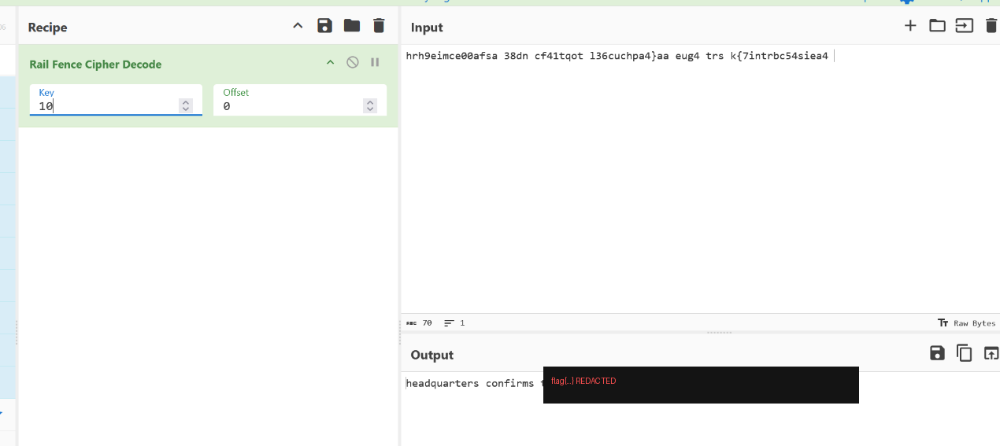

# 栅栏密码还原情报

> 比赛：ISCC 2026　方向：Crypto　作者：杨心凌
>
> 仅在赛事授权的题目环境中复现。Flag 已按投稿规范脱敏。

## 题目信息

- **题目描述：** 截获一段英文加密情报，已知明文是一段自然语言句子，并包含形如 `flag{15 位数字}` 的内容。需要找出正确的栏数并解密。
- **加密方式：** 栅栏密码（Rail Fence），把明文按锯齿形写在若干栏上，再逐行读出密文。
- **密文：**

  ```text
  hrh9eimce00afsa 38dn cf41tqot l36cuchpa4}aa eug4 trs k{7intrbc54siea4
  ```

- **关键线索：** 明文是可读英文，可用“枚举栏数 + 可读性判断”确定参数。

## 解题思路

1. 栅栏密码的栏数未知，但明文是自然语言，因此遍历 2–10 栏逐一解密，挑出语义通顺的一条即可。
2. 手工画表容易出错，直接用 CyberChef 的 `Rail Fence Cipher Decode`；key=10、offset=0 时得到可读句子。
3. 从解出的句子中提取 `flag{...}` 提交。

## 分析与复现

### 第一步：CyberChef 解密

输入密文，选择 `Rail Fence Cipher Decode`，参数 Key=10、Offset=0，得到：



输出为 `headquarters confirms the backup cache flag{...} is intact`，花括号内是 15 位数字（Flag 已脱敏）。

### 第二步：脚本复现

```python
def rail_fence_decode(cipher: str, rails: int = 10) -> str:
    n = len(cipher)
    pattern, r, step = [], 0, 1
    for _ in range(n):                 # 生成锯齿形行号序列
        pattern.append(r)
        r += step
        if r == 0 or r == rails - 1:
            step = -step

    counts = [pattern.count(i) for i in range(rails)]  # 每栏字符数
    rails_text, pos = [], 0
    for cnt in counts:                 # 按行切分密文
        rails_text.append(list(cipher[pos:pos + cnt]))
        pos += cnt

    idx = [0] * rails                  # 按锯齿序列逐行取字符
    out = []
    for row in pattern:
        out.append(rails_text[row][idx[row]])
        idx[row] += 1
    return "".join(out)

cipher = "hrh9eimce00afsa 38dn cf41tqot l36cuchpa4}aa eug4 trs k{7intrbc54siea4"
print(rail_fence_decode(cipher, 10))
```

## 核心代码

同上的 `rail_fence_decode`。若使用 CyberChef，只需 Key=10、Offset=0，无需写代码。

## 结果验证

解出的句子里 `flag{...}`（15 位数字）与题目“flag 内为 15 位数字”的描述一致；按投稿规范统一脱敏，赛事期间提交原值即可。

## 复盘与经验

- **关键知识点：** 栅栏密码的栏数与偏移、栏数枚举、利用语言可读性判别正确参数。
- **容易踩的坑：** 栏数较多时手工画表容易错行；密文中的空格也参与换位，随意裁剪空格会破坏结果。
- **后续改进：** 换位类密码不提供机密性保障，真实场景应使用 AES-GCM 等认证加密。

## 参考资料

- [CyberChef](https://gchq.github.io/CyberChef/) — 在线加解密工具，含 Rail Fence Cipher。
- [Wikipedia - Rail fence cipher](https://en.wikipedia.org/wiki/Rail_fence_cipher) — 原理说明。
